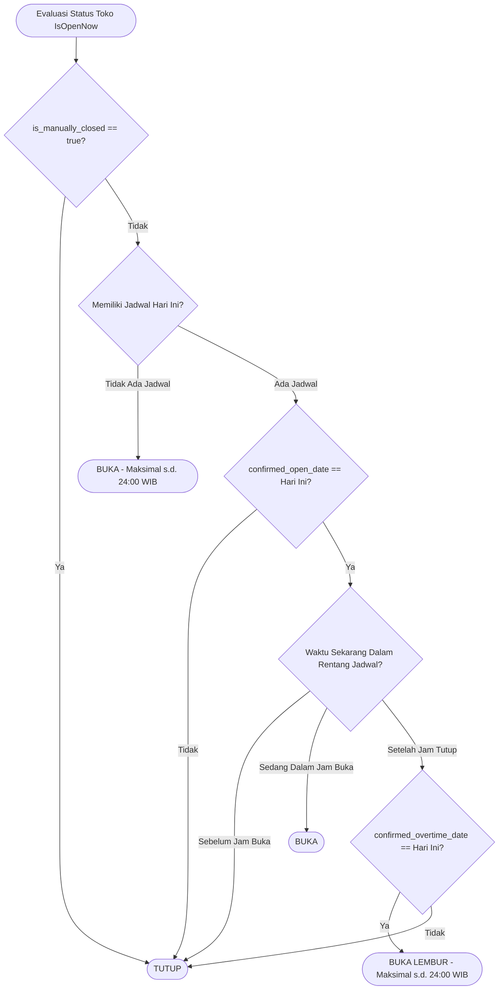
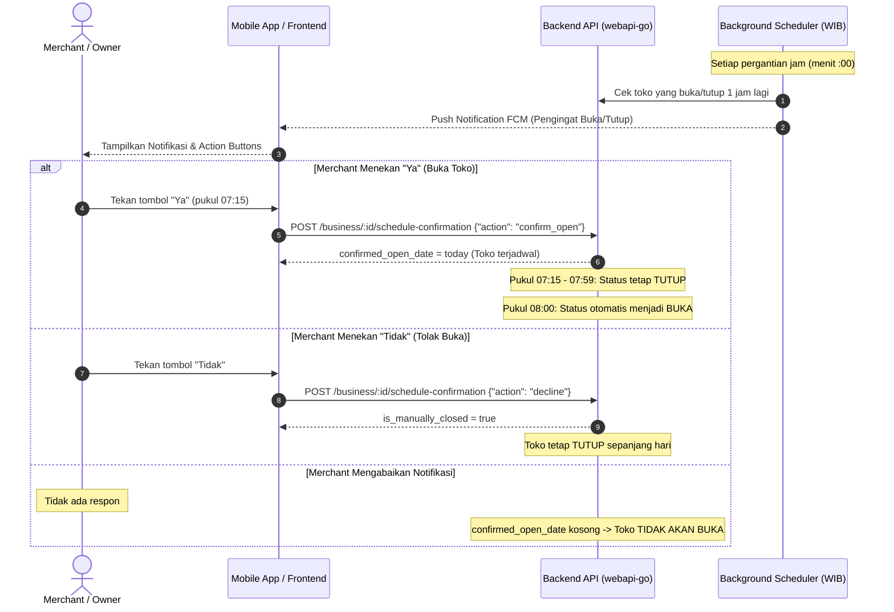

# Dokumentasi Alur Notifikasi & Aturan Aktivasi Buka/Tutup Toko

Dokumen ini menjelaskan arsitektur logika, jadwal operasional, alur notifikasi reminder (pengingat), visual tampilan notifikasi (Push Notification & In-App Pop-up), serta seluruh skenario buka/tutup toko pada sistem **ToenToen**.

---

## 1. Prinsip Dasar & Aturan Utama (Core Principles)

1. **Default Toko Selalu "Tutup"**:
   - Setiap toko secara default berada dalam status `Tutup` (`is_manually_closed = true`).
   - Toko hanya dapat buka jika ada konfirmasi pembukaan harian atau diaktifkan oleh merchant.
2. **Kunci Zona Waktu WIB (GMT+7)**:
   - Seluruh evaluasi hari, jam, menit, dan pergantian tanggal dihitung berdasarkan zona waktu Indonesia Barat (`Asia/Jakarta`).
3. **Konfirmasi Harian Toko Terjadwal**:
   - Toko yang memiliki jadwal operasional (`hours`) hanya akan berstatus `IsOpenNow = true` jika merchant mengonfirmasi pembukaan untuk hari tersebut (`confirmed_open_date == tanggal_hari_ini`).
   - Jika merchant menekan konfirmasi lebih awal (misal menekan "Ya" pukul 07:15 untuk jadwal buka 08:00), toko **belum langsung buka di 07:15**, melainkan dijadwalkan buka tepat pukul **08:00**.
4. **Batas Maksimal Lembur / Overtime**:
   - Jika merchant memilih tetap buka melebihi jam tutup reguler, toko akan tetap buka maksimal sampai **pukul 24:00 (00:00 WIB)**.
5. **Auto-Reset Tengah Malam (00:00 WIB)**:
   - Setiap pergantian hari pukul 00:00 WIB, cron worker otomatis:
     - Mereset seluruh status toko menjadi `Tutup` (`is_manually_closed = true`).
     - Mematikan siaran langsung (live streaming) toko yang masih menyala (`is_live = false`).
     - Mengirim notifikasi penutupan sesi live streaming kepada customer.

---

## 2. Diagram Alur Keputusan Status Toko (`IsOpenNow`)



---

## 3. Visual & Bentuk Tampilan Notifikasi (UI Mockup)

Sistem menyediakan 2 media penyampaian konfirmasi kepada merchant:
1. **Push Notification (Tray / Lockscreen Banner)** saat merchant sedang berada di luar aplikasi.
2. **In-App Pop-up / Bottom Sheet Dialog** saat merchant membuka atau sedang aktif di aplikasi.

---

### Tampilan 1: Push Notification Tray (Lockscreen / Notification Bar)

```text
+--------------------------------------------------------------------------+
|  [ToenToen Merchant] • Sekarang                                          |
|  ⏰ Pengingat Buka Toko: Warung Berkah Kopi                              |
|  Apakah toko Warung Berkah Kopi akan buka 1 jam lagi sesuai jadwal       |
|  (jam 08:00)?                                                            |
|                                                                          |
|  [  ✅ YA, BUKA (08:00)  ]        [  ❌ TIDAK / TETAP TUTUP  ]           |
+--------------------------------------------------------------------------+
```

* **Action Button `[ YA, BUKA ]`**: Mengirim payload `{"action": "confirm_open"}` langsung ke API tanpa harus membuka halaman lain.
* **Action Button `[ TIDAK ]`**: Mengirim payload `{"action": "decline"}`.
* **Klik Teks Notifikasi**: Membuka aplikasi langsung ke Dashboard Merchant dan memunculkan In-App Bottom Sheet.

---

### Tampilan 2: In-App Pop-up Dialog / Bottom Sheet (Di Dalam Aplikasi)

```text
+--------------------------------------------------------------------------+
|                                                                          |
|                           ⏰ PENGINGAT JADWAL                            |
|                                                                          |
|                     Konfirmasi Buka Toko Hari Ini                        |
|                                                                          |
|    Halo Merchant! Toko "Warung Berkah Kopi" dijadwalkan buka pada:       |
|                             🕒 08:00 WIB                                 |
|                                                                          |
|    Apakah toko Anda siap menerima pesanan dan akan buka tepat di jam    |
|    08:00 sesuai jadwal?                                                  |
|                                                                          |
|    +----------------------------------------------------------------+    |
|    |               ✅ Ya, Buka Tepat Pukul 08:00                    |    |
|    +----------------------------------------------------------------+    |
|    |                   ❌ Tidak, Tetap Tutup Hari Ini                |    |
|    +----------------------------------------------------------------+    |
|                                                                          |
+--------------------------------------------------------------------------+
```

---

## 4. Seluruh Skenario Notifikasi & Respon Merchant



---

### Skenario A: Pengingat 1 Jam Sebelum Buka (Jadwal Reguler)
> **Contoh**: Toko dijadwalkan buka pukul **08:00** dan tutup pukul **21:00**.

#### 1. Pesan Notifikasi (Pukul 07:00 WIB):
* **Judul**: `⏰ Pengingat Buka Toko: [Nama Toko]`
* **Body**: *"Apakah toko [Nama Toko] akan buka 1 jam lagi sesuai jadwal (jam 08:00)?"*
* **Tindakan**:
  * Pilihan 1: **"Ya"** (`confirm_open`)
  * Pilihan 2: **"Tidak"** (`decline`)

#### 2. Dampak Respon:
| Pilihan Merchant | Waktu Klik | Respon Sistem / Status Toko |
|---|---|---|
| **Menekan "Ya"** | Pukul 07:15 WIB | Sistem mencatat `confirmed_open_date = Hari Ini`. Pukul 07:15 - 07:59 status toko tetap **Tutup**. Tepat pukul 08:00 WIB toko otomatis menjadi **Buka**. |
| **Menekan "Tidak"** | Pukul 07:15 WIB | Sistem mencatat `is_manually_closed = true`. Toko **Tutup** sepanjang hari. |
| **Diabaikan (Tidak dijawab)** | - | Toko **TIDAK AKAN OTOMATIS BUKA** pada pukul 08:00 (tetap Tutup demi keselamatan operasional). |

---

### Skenario B: Pengingat 1 Jam Sebelum Tutup & Opsi Lembur (Overtime)
> **Contoh**: Toko buka reguler dan dijadwalkan tutup pukul **21:00**.

#### 1. Pesan Notifikasi (Pukul 20:00 WIB):
* **Judul**: `⏱️ Pengingat Tutup Toko: [Nama Toko]`
* **Body**: *"Apakah toko [Nama Toko] akan tutup sesuai jadwal di jam 21:00?"*
* **Tindakan**:
  * Pilihan 1: **"Ya, Tutup Sesuai Jadwal"** (`decline`)
  * Pilihan 2: **"Tidak, Lanjut Buka (Lembur)"** (`confirm_overtime`)

#### 2. Dampak Respon:
| Pilihan Merchant | Respon Sistem / Status Toko |
|---|---|
| **Pilih "Ya, Tutup Sesuai Jadwal"** | Toko tetap buka sampai 21:00. Tepat pukul 21:00 WIB, toko otomatis berubah menjadi **Tutup**. |
| **Pilih "Tidak, Lanjut Buka (Lembur)"** | Sistem mencatat `confirmed_overtime_date = Hari Ini`. Setelah pukul 21:00 (misal 21:30 atau 23:00), toko **TETAP BUKA**. Status buka ini bertahan maksimal hingga **pukul 24:00 (00:00 WIB)**. |
| **Diabaikan (Tidak dijawab)** | Sistem mengikuti jadwal default: tepat pukul 21:00 WIB toko otomatis **Tutup**. |

---

### Skenario C: Pengingat 23:00 WIB — Toko Bersambung Lintas Hari / Toko 24 Jam
> **Contoh**: Toko 24 Jam ATAU Toko dengan jadwal bersambung (Selasa 08:00 - 24:00, Rabu 00:00 - 22:00).

#### 1. Pesan Notifikasi (Pukul 23:00 WIB):
* **Judul**: `🌙 Konfirmasi Lanjut Buka: [Nama Toko]`
* **Body**: *"Apakah toko [Nama Toko] akan lanjut buka setelah jam 24.00 sesuai jadwal toko?"*
* **Tindakan**:
  * Pilihan 1: **"Ya, Lanjut Buka"** (`confirm_open`)
  * Pilihan 2: **"Tidak, Tutup Jam 24.00"** (`decline`)

#### 2. Dampak Respon:
| Pilihan Merchant | Respon Sistem / Status Toko |
|---|---|
| **Menekan "Ya"** | Sistem mengonfirmasi izin buka untuk hari berikutnya. Ketika jam 00:00 WIB tiba, toko **LANGSUNG LANJUT BUKA** tanpa terputus. |
| **Menekan "Tidak" atau Diabaikan** | Tepat pukul 00:00 WIB, worker tengah malam otomatis mengubah status toko menjadi **Tutup**. |

---

### Skenario D: Toko Tanpa Jadwal Operasional (`hours = []`)
> **Kondisi**: Toko belum mengatur jadwal operasional sama sekali.

1. **Aktivasi Manual**:
   - Toko hanya berstatus **Buka** jika merchant mengaktifkannya secara manual melalui toggle buka/tutup di dashboard.
2. **Tanpa Notifikasi Pengingat**:
   - Karena tidak ada jadwal buka/tutup, sistem tidak mengirimkan pengingat jam 07:00 atau jam 20:00.
3. **Batas Akhir Tengah Malam**:
   - Status buka berlaku hingga pukul **24:00 (00:00 WIB)**. Pada pukul 00:00 WIB, sistem otomatis me-reset toko menjadi **Tutup**.

---

### Skenario E: Reset Otomatis Tengah Malam (00:00 WIB)
> **Waktu Eksekusi**: Setiap hari tepat pukul **00:00 WIB**.

Worker menjalankan tugas harian pembersihan menyeluruh:
1. Menyetel seluruh toko menjadi `is_manually_closed = true`.
2. Mematikan sesi siaran langsung (Live Streaming) toko yang masih berjalan (`is_live = false`).
3. Mengirimkan notifikasi penutupan siaran kepada pelanggan yang mem-bookmark toko:
   - **Judul**: `🏁 Sesi Live Streaming [Nama Toko] Telah Berakhir`
   - **Body**: *"Siaran langsung toko [Nama Toko] telah selesai. Terima kasih atas partisipasi Anda!"*

---

## 5. Matriks Ringkasan Skenario & Parameter API

| No | Tipe Skenario | Pemicu Waktu | Parameter Action API | Payload JSON |
|---|---|---|---|---|
| 1 | Konfirmasi Buka Toko | 1 Jam Sebelum Buka | `confirm_open` | `{"action": "confirm_open"}` |
| 2 | Tolak Buka (Tetap Tutup) | 1 Jam Sebelum Buka | `decline` | `{"action": "decline"}` |
| 3 | Konfirmasi Tutup Sesuai Jadwal | 1 Jam Sebelum Tutup | `decline` | `{"action": "decline"}` |
| 4 | Konfirmasi Lembur (Overtime) | 1 Jam Sebelum Tutup | `confirm_overtime` | `{"action": "confirm_overtime"}` |
| 5 | Lanjut Buka 24 Jam / Tengah Malam | Pukul 23:00 WIB | `confirm_open` | `{"action": "confirm_open"}` |
| 6 | Berhenti Buka di Jam 24:00 | Pukul 23:00 WIB | `decline` | `{"action": "decline"}` |

---

## 6. Spesifikasi Data Notifikasi FCM (Firebase Cloud Messaging)

Payload data yang dikirimkan oleh backend ke aplikasi merchant:

```json
{
  "to": "<FCM_TOKEN_MERCHANT>",
  "notification": {
    "title": "⏰ Pengingat Buka Toko: Warung Berkah Kopi",
    "body": "Apakah toko Warung Berkah Kopi akan buka 1 jam lagi sesuai jadwal (jam 08:00)?"
  },
  "data": {
    "action_type": "schedule_confirmation",
    "confirmation_type": "confirm_open",
    "business_id": "BUS-9B8A7C6D",
    "business_name": "Warung Berkah Kopi",
    "target_time": "08:00",
    "screen": "merchant_dashboard",
    "click_action": "CONFIRM_OPEN_CLICK"
  }
}
```

### Variasi Field `confirmation_type`:
* `"confirm_open"`: Untuk pengingat buka (1 jam sebelum) dan pengingat lanjut buka tengah malam (jam 23:00).
* `"confirm_overtime"`: Untuk pengingat tutup (1 jam sebelum) guna menawarkan opsi lembur.
