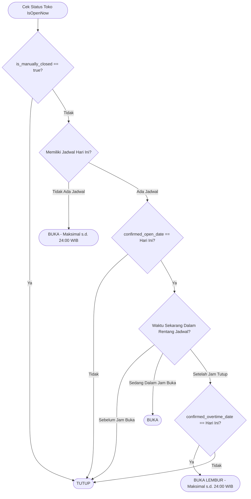

# Dokumentasi Alur Notifikasi & Aturan Aktivasi Buka/Tutup Toko

Dokumen ini menjelaskan arsitektur logika, jadwal operasional, alur notifikasi reminder (pengingat), serta skenario buka/tutup toko pada sistem **ToenToen**.

---

## 1. Prinsip Dasar & Aturan Utama (Core Principles)

1. **Default Toko Selalu "Tutup"**:
   - Setiap toko secara default berada dalam status `Tutup` (`is_manually_closed = true`).
   - Toko hanya dapat buka jika ada konfirmasi pembukaan harian atau diaktifkan oleh merchant.
2. **Kunci Zona Waktu WIB (GMT+7)**:
   - Seluruh evaluasi hari, jam, menit, dan pergantian tanggal dihitung berdasarkan zona waktu Indonesia Barat (`Asia/Jakarta`).
3. **Konfirmasi Harian Toko Terjadwal**:
   - Toko yang memiliki jadwal operasional (`hours`) hanya akan berstatus `IsOpenNow = true` jika merchant mengonfirmasi pembukaan untuk hari tersebut (`confirmed_open_date == tanggal_hari_ini`).
   - Jika merchant menekan konfirmasi lebih awal (misal menekan "Ya" pukul 07:15 untuk jadwal buka 08:00), toko **belum langsung buka di 07:15**, melainkan dijadwalkan buka tepat pukul **08:00**.
4. **Batas Maksimal Lembur / Overtime**:
   - Jika merchant memilih tetap buka melebihi jam tutup reguler, toko akan tetap buka maksimal sampai **pukul 24:00 (00:00 WIB)**.
5. **Auto-Reset Tengah Malam (00:00 WIB)**:
   - Setiap pergantian hari pukul 00:00 WIB, cron worker otomatis:
     - Mereset seluruh status toko menjadi `Tutup` (`is_manually_closed = true`).
     - Mematikan siaran langsung (live streaming) toko yang masih menyala (`is_live = false`).
     - Mengirim notifikasi penutupan sesi live streaming kepada customer.

---

## 2. Diagram Alur Keputusan Status Toko (`IsOpenNow`)



---

## 3. Rincian Skenario Notifikasi & Respon Merchant

### Skenario 1: Jadwal Reguler — Pengingat Buka (H-1 Jam)
> **Contoh Kasus**: Jadwal toko hari ini adalah **08:00 - 21:00**.

| Waktu | Kejadian | Pesan Notifikasi |
|---|---|---|
| **07:00 WIB** (H-1 Jam) | Worker mendeteksi jam buka pukul 08:00. | *"Apakah toko Anda akan buka 1 jam lagi sesuai jadwal (Jika 'Ya', toko akan berubah menjadi 'Buka' di jam 08:00 nanti.)?"* |

#### Pilihan Respon Merchant:
* **Kasus 1A: Merchant Menekan "Ya" (pukul 07:15)**:
  - Frontend memanggil API: `POST /business/:id/schedule-confirmation` dengan body `{"action": "confirm_open"}`.
  - Server mencatat `confirmed_open_date = Hari Ini`, `is_manually_closed = false`.
  - Pukul 07:15 - 07:59: Status toko tetap **Tutup** (karena jam buka resmi adalah 08:00).
  - Tepat pukul 08:00: Status toko otomatis berubah menjadi **Buka**.
* **Kasus 1B: Merchant Menekan "Tidak"**:
  - Frontend memanggil API: `POST /business/:id/schedule-confirmation` dengan body `{"action": "decline"}`.
  - Server menyetel `is_manually_closed = true`.
  - Toko tetap **Tutup** sepanjang hari sampai merchant mengubah toggle secara manual.
* **Kasus 1C: Merchant Tidak Menjawab / Mengabaikan Notifikasi**:
  - `confirmed_open_date` tetap kosong.
  - Pukul 08:00 ke atas: Toko **TIDAK AKAN OTOMATIS BUKA** (status tetap **Tutup** demi keamanan merchant jika toko belum siap).

---

### Skenario 2: Jadwal Reguler — Pengingat Tutup & Lembur (H-1 Jam)
> **Contoh Kasus**: Jadwal toko hari ini tutup pukul **21:00**.

| Waktu | Kejadian | Pesan Notifikasi |
|---|---|---|
| **20:00 WIB** (H-1 Jam) | Worker mendeteksi jam tutup pukul 21:00. | *"Apakah Toko Anda akan tutup sesuai jadwal di jam 21:00?"* |

#### Pilihan Respon Merchant:
* **Kasus 2A: Merchant Menekan "Ya" (Tutup Sesuai Jadwal)**:
  - Frontend memanggil API: `{"action": "decline"}`.
  - Toko tetap melayani pelanggan sampai pukul 21:00. Tepat pukul 21:00, toko otomatis berubah menjadi **Tutup**.
* **Kasus 2B: Merchant Menekan "Tidak" (Lanjut Buka / Lembur)**:
  - Frontend memanggil API: `{"action": "confirm_overtime"}`.
  - Server mencatat `confirmed_overtime_date = Hari Ini`.
  - Setelah pukul 21:00 (misal 21:30 atau 22:45), toko **TETAP BUKA**.
  - Batas maksimal lembur adalah pukul **24:00 (00:00 WIB)**, di mana worker harian akan otomatis menutup toko.
* **Kasus 2C: Merchant Mengabaikan Notifikasi**:
  - `confirmed_overtime_date` tidak tercatat.
  - Tepat pukul 21:00, toko otomatis berubah menjadi **Tutup** sesuai jam operasional reguler.

---

### Skenario 3: Toko Bersambung / Toko 24 Jam (Pengingat 23:00 WIB)
> **Contoh Kasus**: 
> - Toko 24 Jam (00:00 - 24:00), ATAU
> - Toko dengan jam bersambung (Selasa: 08:00 - 24:00, Rabu: 00:00 - 22:00).

| Waktu | Kejadian | Pesan Notifikasi |
|---|---|---|
| **23:00 WIB** (H-1 Jam Tengah Malam) | Worker mendeteksi toko buka s.d. 24:00 dan bersambung ke hari esok. | *"Apakah toko Anda akan lanjut buka setelah jam 24.00 sesuai jam buka toko? (Jika 'Ya', toko akan lanjut menjadi 'Buka' di jam 00.00 nanti.)"* |

#### Pilihan Respon Merchant:
* **Kasus 3A: Merchant Menekan "Ya"**:
  - Frontend memanggil API: `{"action": "confirm_open"}`.
  - Toko berlanjut buka melewati jam 00:00 WIB pada hari berikutnya sesuai jadwal.
* **Kasus 3B: Merchant Menekan "Tidak" atau Mengabaikan Notifikasi**:
  - Tepat pukul 00:00 WIB tengah malam, worker harian otomatis mengubah status toko menjadi **Tutup**.

---

### Skenario 4: Toko Tanpa Jadwal Operasional (`hours = []`)
> **Kondisi**: Merchant belum mengatur jadwal jam buka-tutup di profil toko.

1. **Aktivasi Manual**:
   - Toko hanya bisa buka jika merchant menggeser toggle "Buka" secara manual di aplikasi merchant.
2. **Durasi Buka**:
   - Status buka hanya berlaku pada hari berjalan sampai **pukul 24:00 (00:00 WIB)**.
3. **Auto-Close Tengah Malam**:
   - Pada pukul 00:00 WIB, toko otomatis ditutup oleh worker (`is_manually_closed = true`). Merchant harus mengaktifkan toggle kembali jika ingin buka di hari berikutnya.

---

## 4. Matriks Ringkasan Keputusan Sistem

| Tipe Toko | Kondisi Waktu | Konfirmasi Merchant | Status Toko (`IsOpenNow`) |
|---|---|---|---|
| **Terjadwal** | Sebelum jam buka (< 08:00) | Sudah tekan "Ya" (`confirm_open`) | **Tutup** (Menunggu tepat jam buka) |
| **Terjadwal** | Dalam rentang buka (08:00 - 21:00) | Sudah tekan "Ya" (`confirm_open`) | **Buka** |
| **Terjadwal** | Dalam rentang buka (08:00 - 21:00) | Belum konfirmasi / tekan "Tidak" | **Tutup** |
| **Terjadwal** | Lewat jam tutup (> 21:00) | Tekan lembur (`confirm_overtime`) | **Buka** (Maksimal s.d. 24:00 WIB) |
| **Terjadwal** | Lewat jam tutup (> 21:00) | Tidak lembur / Tanpa respon | **Tutup** |
| **Bersambung / 24 Jam** | Jam 23:00 - 00:00 | Tekan "Ya" lanjut buka | **Tetap Buka** setelah 00:00 |
| **Bersambung / 24 Jam** | Jam 23:00 - 00:00 | Tidak dijawab / Tekan "Tidak" | **Tutup** otomatis pukul 00:00 WIB |
| **Tanpa Jadwal** | Kapan saja | Toggle Buka manual | **Buka** s.d. 24:00 WIB |
| **Semua Tipe Toko** | Pukul 00:00 WIB | Reset Harian Otomatis | **Tutup** |

---

## 5. Spesifikasi Teknis Integrasi Frontend / Mobile

### Endpoint Konfirmasi Jadwal
- **URL**: `POST /business/:business_id/schedule-confirmation`
- **Headers**:
  ```http
  Authorization: Bearer <access_token>
  Content-Type: application/json
  ```
- **Permission**: Owner Toko atau Business Admin dengan permission `manage_store_status`.

### Format Request Payload:

1. **Konfirmasi Buka Toko (Tombol "Ya" pada Pengingat Buka / Bersambung):**
   ```json
   {
     "action": "confirm_open"
   }
   ```
2. **Konfirmasi Lembur (Tombol "Tidak" pada Pengingat Tutup):**
   ```json
   {
     "action": "confirm_overtime"
   }
   ```
3. **Tolak Buka / Konfirmasi Tutup (Tombol "Tidak" Buka atau "Ya" Tutup):**
   ```json
   {
     "action": "decline"
   }
   ```

### Format Payload Notifikasi FCM (Push Notification):
```json
{
  "to": "<FCM_TOKEN>",
  "notification": {
    "title": "⏰ Pengingat Jadwal Operasional Toko",
    "body": "Apakah toko Anda akan buka 1 jam lagi sesuai jadwal di jam 08:00?"
  },
  "data": {
    "type": "schedule_reminder",
    "business_id": "BUS-XXXXXX",
    "reminder_type": "open",
    "schedule_time": "08:00:00",
    "screen": "store_status_dialog",
    "click_action": "FLUTTER_NOTIFICATION_CLICK"
  }
}
```
*Nilai `reminder_type`*:
- `"open"`: Pengingat 1 jam sebelum jam buka reguler.
- `"continue_midnight"`: Pengingat pukul 23:00 untuk toko bersambung/24 jam.
- `"close"`: Pengingat 1 jam sebelum jam tutup reguler.
