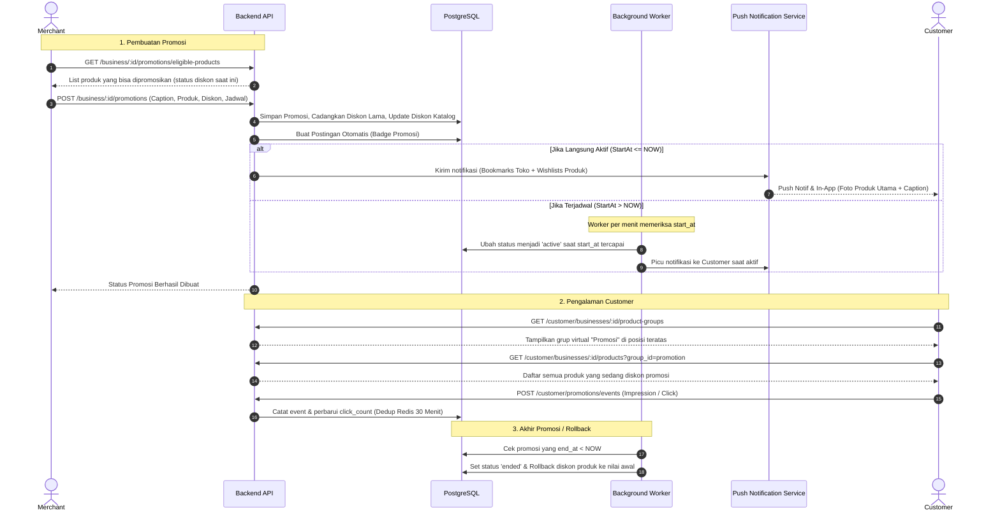

# Panduan & Spesifikasi Lengkap Flow API Promosi Toko (Merchant Promotions)

Dokumen ini menjelaskan arsitektur, siklus hidup (*lifecycle*), kontrak payload permintaan/respons, serta integrasi lengkap sistem **Promosi Toko** baik untuk sisi Merchant (Owner & Business Admin) maupun sisi Customer (Feed, Notifikasi, dan Etalase Toko).

---

## Daftar Isi
1. [Arsitektur & Konsep Utama](#1-arsitektur--konsep-utama)
2. [Diagram Siklus Hidup & Alur End-to-End](#2-diagram-siklus-hidup--alur-end-to-end)
3. [Daftar Endpoint Merchant](#3-daftar-endpoint-merchant)
   - [3.1 Ambil Produk Eligible](#31-ambil-produk-eligible)
   - [3.2 Buat Promosi Baru](#32-buat-promosi-baru)
   - [3.3 Daftar Promosi (Tab Active, Popular, Ended)](#33-daftar-promosi-tab-active-popular-ended)
   - [3.4 Detail Promosi](#34-detail-promosi)
   - [3.5 Perpanjang Masa Promosi](#35-perpanjang-masa-promosi)
   - [3.6 Hentikan Promosi Lebih Awal](#36-hentikan-promosi-lebih-awal)
4. [Daftar Endpoint Customer](#4-daftar-endpoint-customer)
   - [4.1 Tracking Impresi & Klik Promosi](#41-tracking-impresi--klik-promosi)
   - [4.2 Detail Promosi untuk Customer](#42-detail-promosi-untuk-customer)
5. [Integrasi Etalase Virtual "Promosi"](#5-integrasi-etalase-virtual-promosi)
6. [Integrasi Postingan Feed & Kontrol Promosi Postingan](#6-integrasi-postingan-feed--kontrol-promosi-postingan)
   - [6.1 Atribut Respons Postingan Promosi](#61-atribut-respons-postingan-promosi)
   - [6.2 Buat Postingan Promosi (Merchant)](#62-buat-postingan-promosi-merchant)
   - [6.3 Hentikan Promosi Postingan (Stop Promotion)](#63-hentikan-promosi-postingan-stop-promotion)
   - [6.4 Perpanjang Masa Promosi Postingan (Extend Promotion)](#64-perpanjang-masa-promosi-postingan-extend-promotion)
   - [6.5 Mekanisme Auto-Berhenti / Auto-Expire Postingan](#65-mekanisme-auto-berhenti--auto-expire-postingan)
7. [Mekanisme Notifikasi & Deduplikasi](#7-mekanisme-notifikasi--deduplikasi)
8. [Background Scheduler & Worker](#8-background-scheduler--worker)

---

## 1. Arsitektur & Konsep Utama

### 1.1 Status Promosi
Promosi memiliki 4 status kemungkinan:
- `scheduled`: Tanggal mulai (`start_at`) berada di masa mendatang (akan diaktifkan otomatis oleh worker saat waktunya tiba).
- `active`: Promosi sedang berjalan aktif saat ini (`start_at <= NOW <= end_at`). Diskon produk diterapkan langsung ke katalog.
- `ended`: Promosi selesai secara alami karena melewati batas waktu `end_at`. Diskon otomatis di-rollback ke kondisi sebelum promo.
- `stopped`: Dihentikan lebih awal secara manual oleh merchant. Diskon otomatis di-rollback seketika.

### 1.2 Penanganan Diskon Sebelumnya (Rollback vs Keep)
Saat merchant memilih produk yang sebelumnya sudah memiliki diskon di katalog:
1. **Opsi `keep_existing_discount: true`**: Nilai diskon produk saat ini dipertahankan, namun masa berlaku diskon (`discount_end_at`) diperpanjang mengikuti `end_at` promosi.
2. **Opsi Ubah Diskon Baru (`keep_existing_discount: false`)**: Nilai diskon lama (tipe, nominal/persen, batas tanggal) dicadangkan ke tabel `promotion_products`. Diskon produk di katalog ditimpa dengan diskon promosi. Saat promosi berakhir atau dihentikan, diskon lama akan dipulihkan secara otomatis.

### 1.3 Penguncian Diskon Produk
Selama produk terdaftar dalam promosi yang berstatus `scheduled` atau `active`, pengubahan diskon secara manual melalui endpoint katalog `PUT /business/:business_id/products/:product_id` akan **diblokir** oleh sistem untuk mencegah inkonsistensi data.

---

## 2. Diagram Siklus Hidup & Alur End-to-End



---

## 3. Daftar Endpoint Merchant

Semua endpoint merchant berada di bawah scope otorisasi bisnis:
- **Base URL:** `/business/:business_id/promotions` (atau alias `/merchant/businesses/:business_id/promotions`)
- **Headers:** `Authorization: Bearer <token>`
- **Izin Admin:** Memerlukan izin `manage_promotions` bagi staf `business_admin`.

---

### 3.1 Ambil Produk Eligible
Mengambil daftar semua produk aktif milik toko yang **belum terikat** dalam promosi aktif atau terjadwal lain.

- **Method:** `GET`
- **URL:** `/business/:business_id/promotions/eligible-products`
- **Response Success (200 OK):**
```json
{
  "responseCode": "00",
  "message": "Daftar produk eligible berhasil diambil",
  "data": [
    {
      "product_id": "PRD-abc12345",
      "product_name": "Kopi Susu Gula Aren",
      "image_url": "https://s3.../preview.jpg",
      "price": 25000,
      "is_eligible": true,
      "has_existing_discount": true,
      "current_discount_type": "percentage",
      "current_discount": 10,
      "current_max_discount": null,
      "current_discount_start_at": "2026-10-01T00:00:00Z",
      "current_discount_end_at": "2026-10-25T23:59:59Z"
    },
    {
      "product_id": "PRD-xyz98765",
      "product_name": "Roti Bakar Cokelat Keju",
      "image_url": "https://s3.../roti.jpg",
      "price": 20000,
      "is_eligible": true,
      "has_existing_discount": false,
      "current_discount_type": "",
      "current_discount": 0,
      "current_max_discount": null,
      "current_discount_start_at": null,
      "current_discount_end_at": null
    }
  ]
}
```

---

### 3.2 Buat Promosi Baru
Membuat promosi toko, menetapkan produk promosi, memilih produk utama untuk preview notifikasi/postingan, dan mengatur diskon masing-masing produk.

- **Method:** `POST`
- **URL:** `/business/:business_id/promotions`
- **Middleware:** `RequireAuth`, `RequireKYC`, `BusinessAccessGuard`
- **Payload Request:**
```json
{
  "caption": "Promo Gajian Spesial! Nikmati diskon hingga 30% untuk menu favorit Anda.",
  "main_product_id": "PRD-abc12345",
  "start_at": "2026-10-20T08:00:00+07:00",
  "end_at": "2026-10-27T23:59:59+07:00",
  "products": [
    {
      "product_id": "PRD-abc12345",
      "keep_existing_discount": true
    },
    {
      "product_id": "PRD-xyz98765",
      "keep_existing_discount": false,
      "discount_type": "percentage",
      "discount": 20,
      "max_discount": 10000
    }
  ]
}
```

#### Aturan Validasi:
1. `caption`: Wajib diisi, minimal 3 karakter, **maksimal 150 karakter**.
2. `main_product_id`: Wajib dipilih dan **harus termasuk** dalam daftar `products`.
3. `start_at` & `end_at`: Rentang promosi tidak boleh melebihi **90 hari**.
4. `products`: Minimal 1 produk, **maksimal 20 produk**.
5. Diskon:
   - Jika `keep_existing_discount: true`, sistem menggunakan nilai diskon yang sudah ada di produk tersebut.
   - Jika `keep_existing_discount: false`, `discount_type` ("percentage" atau "nominal") dan `discount` wajib diisi valid.

- **Response Success (201 Created):**
```json
{
  "responseCode": "00",
  "message": "Promosi berhasil dibuat",
  "data": {
    "promotion_id": "PRM-1a2b3c4d",
    "business_id": "BIZ-001",
    "caption": "Promo Gajian Spesial! Nikmati diskon hingga 30% untuk menu favorit Anda.",
    "status": "scheduled",
    "start_at": "2026-10-20T08:00:00+07:00",
    "end_at": "2026-10-27T23:59:59+07:00",
    "days_remaining": 7,
    "main_product": {
      "product_id": "PRD-abc12345",
      "product_name": "Kopi Susu Gula Aren",
      "image_url": "https://s3.../preview.jpg"
    },
    "products_count": 2,
    "impression_count": 0,
    "click_count": 0,
    "created_at": "2026-10-19T18:00:00+07:00"
  }
}
```

---

### 3.3 Daftar Promosi (Tab Active, Popular, Ended)
Menampilkan daftar promosi milik toko lengkap dengan ringkasan statistik (metrik).

- **Method:** `GET`
- **URL:** `/business/:business_id/promotions?tab=active`
- **Query Params:**
  - `tab`: Pilihan tab:
    - `active` (Default): Menampilkan promosi yang sedang aktif atau terjadwal.
    - `popular`: Menampilkan promosi aktif yang diurutkan berdasarkan `click_count DESC` (Paling Populer).
    - `ended`: Menampilkan promosi yang sudah selesai atau dihentikan manual.
  - `limit`: Jumlah per halaman (default: 20).
  - `page`: Nomor halaman (default: 1).

- **Response Success (200 OK):**
```json
{
  "responseCode": "00",
  "message": "Daftar promosi berhasil diambil",
  "data": {
    "summary": {
      "active_count": 3,
      "total_impressions": 1250,
      "total_clicks": 340
    },
    "promotions": [
      {
        "promotion_id": "PRM-1a2b3c4d",
        "caption": "Promo Gajian Spesial!",
        "status": "active",
        "start_at": "2026-10-18T00:00:00Z",
        "end_at": "2026-10-25T23:59:59Z",
        "days_remaining": 6,
        "main_product_name": "Kopi Susu Gula Aren",
        "main_product_image": "https://s3.../preview.jpg",
        "original_price": 25000,
        "final_price": 22500,
        "products_count": 2,
        "impression_count": 420,
        "click_count": 95,
        "created_at": "2026-10-18T00:00:00Z"
      }
    ]
  }
}
```

---

### 3.4 Detail Promosi
Melihat rincian sebuah promosi beserta seluruh daftar produk, harga awal, harga diskon, dan status pencadangan.

- **Method:** `GET`
- **URL:** `/business/:business_id/promotions/:promotion_id`
- **Response Success (200 OK):**
```json
{
  "responseCode": "00",
  "message": "Detail promosi berhasil diambil",
  "data": {
    "promotion_id": "PRM-1a2b3c4d",
    "business_id": "BIZ-001",
    "caption": "Promo Gajian Spesial!",
    "status": "active",
    "start_at": "2026-10-18T00:00:00Z",
    "end_at": "2026-10-25T23:59:59Z",
    "days_remaining": 6,
    "main_product_id": "PRD-abc12345",
    "main_product": {
      "product_id": "PRD-abc12345",
      "product_name": "Kopi Susu Gula Aren",
      "image_url": "https://s3.../preview.jpg"
    },
    "impression_count": 420,
    "click_count": 95,
    "post_id": "PST-999888",
    "products": [
      {
        "product_id": "PRD-abc12345",
        "product_name": "Kopi Susu Gula Aren",
        "image_url": "https://s3.../preview.jpg",
        "original_price": 25000,
        "final_price": 22500,
        "discount_type": "percentage",
        "discount": 10,
        "max_discount": null,
        "discount_source": "existing"
      },
      {
        "product_id": "PRD-xyz98765",
        "product_name": "Roti Bakar Cokelat Keju",
        "image_url": "https://s3.../roti.jpg",
        "original_price": 20000,
        "final_price": 16000,
        "discount_type": "percentage",
        "discount": 20,
        "max_discount": 10000,
        "discount_source": "promotion"
      }
    ],
    "created_at": "2026-10-18T00:00:00Z",
    "updated_at": "2026-10-18T00:00:00Z"
  }
}
```

---

### 3.5 Perpanjang Masa Promosi
Memperpanjang masa aktif promosi yang sedang `active` atau `scheduled`. Otomatis memperbarui `discount_end_at` pada produk-produk terkait.

- **Method:** `PATCH`
- **URL:** `/business/:business_id/promotions/:promotion_id/extend`
- **Middleware:** `RequireKYC`
- **Payload Request (Pilih salah satu format):**
  - **Opsi A (Tambah hari):**
    ```json
    {
      "add_days": 3
    }
    ```
  - **Opsi B (Tentukan tanggal akhir baru):**
    ```json
    {
      "end_at": "2026-10-30T23:59:59+07:00"
    }
    ```
- **Response Success (200 OK):**
```json
{
  "responseCode": "00",
  "message": "Masa berlaku promosi berhasil diperpanjang",
  "data": {
    "promotion_id": "PRM-1a2b3c4d",
    "end_at": "2026-10-28T23:59:59Z",
    "days_remaining": 9
  }
}
```

---

### 3.6 Hentikan Promosi Lebih Awal
Menghentikan promosi secara instan sebelum tanggal berakhir. Sistem secara otomatis melakukan **rollback** diskon pada produk:
- Produk yang memiliki diskon lama akan dipulihkan ke nilai diskon aslinya.
- Produk yang awalnya tidak memiliki diskon akan dihapus diskonnya dari katalog.

- **Method:** `PATCH`
- **URL:** `/business/:business_id/promotions/:promotion_id/stop`
- **Middleware:** `RequireKYC`
- **Payload:** Kosong `{}`
- **Response Success (200 OK):**
```json
{
  "responseCode": "00",
  "message": "Promosi berhasil dihentikan dan diskon produk telah dipulihkan",
  "data": {
    "promotion_id": "PRM-1a2b3c4d",
    "status": "stopped"
  }
}
```

---

## 4. Daftar Endpoint Customer

### 4.1 Tracking Impresi & Klik Promosi
Mencatat analitik saat promosi dilihat (*impression*) di feed/timeline/profil atau saat diklik (*click*). Dilengkapi **Deduplikasi 30 Menit** berbasis Redis (atau fallback cache memori) per user/IP agar metrik tidak membengkak karena spam atau scroll bolak-balik.

- **Method:** `POST`
- **URL:** `/customer/promotions/events`
- **Middleware:** `OptionalAuth` (Bisa diakses baik login maupun guest)
- **Payload Request:**
```json
{
  "events": [
    {
      "promotion_id": "PRM-1a2b3c4d",
      "product_id": "PRD-abc12345",
      "event_type": "impression",
      "source": "feed"
    },
    {
      "promotion_id": "PRM-1a2b3c4d",
      "product_id": "PRD-abc12345",
      "event_type": "click",
      "source": "post"
    }
  ]
}
```

- **Nilai `event_type`:** `"impression"` atau `"click"`.
- **Nilai `source`:** `"feed"`, `"post"`, `"business_profile"`, `"notification"`, `"product_group"`.
- **Response Success (200 OK):**
```json
{
  "responseCode": "00",
  "message": "Event promosi berhasil dicatat",
  "data": {
    "recorded_count": 2
  }
}
```

---

### 4.2 Detail Promosi untuk Customer
Mengambil rincian promosi untuk tampilan customer saat mengklik kartu promosi atau notifikasi.

- **Method:** `GET`
- **URL:** `/customer/promotions/:promotion_id`
- **Middleware:** `OptionalAuth`
- **Response Success (200 OK):**
```json
{
  "responseCode": "00",
  "message": "Detail promosi berhasil diambil",
  "data": {
    "promotion_id": "PRM-1a2b3c4d",
    "business_id": "BIZ-001",
    "caption": "Promo Gajian Spesial!",
    "status": "active",
    "start_at": "2026-10-18T00:00:00Z",
    "end_at": "2026-10-25T23:59:59Z",
    "days_remaining": 6,
    "main_product": {
      "product_id": "PRD-abc12345",
      "product_name": "Kopi Susu Gula Aren",
      "image_url": "https://s3.../preview.jpg"
    },
    "products": [ ... ]
  }
}
```

---

## 5. Integrasi Etalase Virtual "Promosi"

### 5.1 Penempatan Otomatis di Paling Atas
Grup etalase **"Promosi"** bersifat *virtual* (tidak dibuat sebagai baris fisik permanen di database tabel `product_groups` agar tidak menghapus kategori asli masing-masing produk).

1. Ketika frontend memanggil:
   - Customer: `GET /customer/businesses/:business_id/product-groups`
   - Merchant: `GET /business/:business_id/product-groups`
2. Jika toko memiliki minimal 1 promosi aktif, backend otomatis menyisipkan objek grup virtual di indeks `0`:
   ```json
   {
     "product_group_id": "promotion",
     "business_id": "BIZ-001",
     "name": "Promosi",
     "display_order": 0,
     "is_active": true
   }
   ```
3. Jika seluruh promosi telah selesai (`ended`/`stopped`), grup virtual ini otomatis hilang dari respons.

### 5.2 Mengambil Produk dalam Grup Promosi
Frontend cukup mengirimkan query parameter `group_id=promotion`:
- **Customer:** `GET /customer/businesses/:business_id/products?group_id=promotion`
- **Merchant:** `GET /business/:business_id/products?product_group_id=promotion`

Backend akan mengeksekusi subquery internal untuk mengambil seluruh produk yang saat ini sedang tergabung dalam promosi aktif toko tersebut lengkap dengan harga diskon aslinya.

---

---

## 6. Integrasi Postingan Feed & Kontrol Promosi Postingan

Sistem mendukung 2 skenario postingan promosi:
1. **Otomatis dari Promosi Katalog:** Dibuat otomatis saat merchant membuat promosi katalog dengan diskon produk (`promotion_id` terisi).
2. **Postingan Promosi Bebas (Standalone):** Dibuat langsung oleh merchant melalui form *Create Post* dengan mencentang toggle *"Promote Post"* (`is_promotion: true`), dengan durasi hari (`duration_days`) atau tanggal berakhir (`promotion_end_at`).

### 6.1 Atribut Respons Postingan Promosi
Postingan feed (`/posts`, `/explore/feed`, `/customer/businesses/:id/posts`) mengembalikan:
- `is_promotion: bool` (otomatis bernilai `false` jika masa promosi sudah habis).
- `promotion_id: string | null` (terisi jika terhubung ke promosi katalog).
- `promotion_end_at: string (ISO8601) | null` (waktu berakhirnya promosi postingan).
- `remaining_days: int | null` (sisa hari promosi, misal `7`, `3`, `1`).
- `badge_text: "Promosi" | null` (hanya muncul saat promosi aktif).
- `target_action: "open_promotion_group" | null` (jika terhubung ke promosi katalog).

---

### 6.2 Buat Postingan Promosi (Merchant)
- **Method & URL:** `POST /api/v1/business/:business_id/posts`
- **Headers:** `Authorization: Bearer <token>`
- **Request Body:**
  ```json
  {
    "content": "Promo Spesial Gajian! Dapatkan penawaran menarik minggu ini.",
    "images": [
      "https://storage.toentoen.com/posts/banner1.jpg"
    ],
    "video_url": "",
    "is_promotion": true,
    "duration_days": 7, // opsional: durasi promosi dalam hari (default: 7 hari)
    "promotion_end_at": "2026-10-28T23:59:59Z" // opsional: tanggal berakhir spesifik
  }
  ```

---

### 6.3 Hentikan Promosi Postingan (Stop Promotion)
Merchant dapat menghentikan label/status promosi pada postingan sewaktu-waktu.
- **Method & URL:** `PATCH /api/v1/business/:business_id/posts/:post_id/promotion/stop`
  *(Tersedia juga alias: `POST /.../promotion/stop` dan `PATCH /.../stop-promotion`)*
- **Headers:** `Authorization: Bearer <token>`
- **Respons (200 OK):**
  ```json
  {
    "responseCode": "00",
    "message": "Promosi postingan berhasil dihentikan",
    "data": null
  }
  ```
> **Catatan Sistem:**
> - Jika postingan terhubung dengan promosi katalog (`promotion_id != null`), sistem juga otomatis menghentikan promosi katalognya dan me-rollback diskon produk kembali ke normal.
> - Postingan tetap ada di timeline toko sebagai postingan biasa, namun status `is_promotion` berubah menjadi `false` dan badge `"Promosi"` dicabut.

---

### 6.4 Perpanjang Masa Promosi Postingan (Extend Promotion)
Merchant dapat memperpanjang masa berlaku promosi postingan.
- **Method & URL:** `PATCH /api/v1/business/:business_id/posts/:post_id/promotion/extend`
  *(Tersedia juga alias: `POST /.../promotion/extend` dan `PATCH /.../extend-promotion`)*
- **Headers:** `Authorization: Bearer <token>`
- **Request Body:**
  ```json
  {
    "add_days": 7 // jumlah hari yang ingin ditambahkan (default: 7 hari jika kosong)
  }
  ```
  *Atau menentukan tanggal baru:*
  ```json
  {
    "end_at": "2026-11-05T23:59:59Z"
  }
  ```
- **Respons (200 OK):**
  ```json
  {
    "responseCode": "00",
    "message": "Promosi postingan berhasil diperpanjang",
    "data": {
      "post_id": "PST-xxx",
      "business_id": "BIZ-xxx",
      "content": "...",
      "is_promotion": true,
      "promotion_end_at": "2026-11-05T23:59:59Z",
      "updated_at": "2026-10-21T14:40:00Z"
    }
  }
  ```

---

### 6.5 Mekanisme Auto-Berhenti / Auto-Expire Postingan
Postingan promosi **TIDAK AKAN PERNAH** selamanya berlabel "Promosi":
1. **Pengecekan Waktu Nyata (API Response Level):** Setiap kali feed atau detail postingan dipanggil, backend langsung membandingkan `promotion_end_at` dengan waktu saat ini (`NOW()`). Jika waktu sudah lewat, backend secara instan mengembalikan `is_promotion: false`, `badge_text: null`, dan `remaining_days: null`.
2. **Background Cleaner (Database Level):** Worker berjalan di latar belakang setiap 1 menit untuk meng-update database:
   ```sql
   UPDATE business_posts SET is_promotion = false, updated_at = NOW() 
   WHERE is_promotion = true AND promotion_end_at IS NOT NULL AND promotion_end_at <= NOW();
   ```
3. **Katalog Promo Sync:** Ketika promosi katalog kedaluwarsa (`ended`) atau dihentikan (`stopped`), postingan feed yang bertaut otomatis dimatikan status promosinya secara serentak.

## 7. Mekanisme Notifikasi & Deduplikasi

### 7.1 Sasaran Penerima
Ketika promosi aktif, notifikasi dipicu ke 2 kelompok customer:
1. Semua customer yang telah melakukan **Bookmark** ke toko tersebut (`business_bookmarks`).
2. Semua customer yang telah menambahkan salah satu produk promosi ke **Wishlist** (`product_wishlists`).

Sistem melakukan penyatuan set (*Set Union*) berbasis `account_id` di database sehingga customer yang mem-bookmark toko sekaligus mem-wishlist produknya **hanya akan menerima 1 notifikasi** (bebas duplikasi).

### 7.2 Format Notifikasi
- **Judul:** `🏷️ Promosi Baru dari [Nama Toko]`
- **Body:** Teks caption promosi yang ditulis oleh merchant (dipotong s.d 150 karakter).
- **Gambar (FCM & In-App):** URL foto preview produk utama (`main_product`).
- **Data Payload:**
  ```json
  {
    "type": "promotion",
    "promotion_id": "PRM-xxxx",
    "business_id": "BIZ-xxxx",
    "image_url": "https://s3.../product_preview.jpg",
    "action": "open_promotion_group"
  }
  ```

---

## 8. Background Scheduler & Worker (Promosi Terjadwal & Auto-Rollback)

Fitur scheduler promosi berjalan secara otomatis di latar belakang tanpa memerlukan cronjob eksternal (OS/crontab), menggunakan goroutine dengan interval berkala setiap **1 menit** (`time.NewTicker(1 * time.Minute)`).

- **File Implementasi:** `internal/domain/merchant/promotion/worker.go`
- **Inisialisasi Server:** Dipanggil langsung saat server API boot di `cmd/api/main.go` via:
  ```go
  merchant_promotion.StartPromotionWorker(database.DB, notifService)
  ```

### 8.1 Alur Kerja Scheduler per Menit

```mermaid
flowchart TD
    Start([Ticker: Setiap 1 Menit]) --> QueryScheduled[Cari promosi: status = 'scheduled' AND start_at <= NOW]
    QueryScheduled --> AnyScheduled{Ada yang perlu aktif?}
    AnyScheduled -- Ya --> LoopScheduled[Iterasi setiap promosi terjadwal]
    LoopScheduled --> DBTx1[Mulai DB Transaction]
    DBTx1 --> UpdateStatusActive[1. Update status = 'active' & notified_at = NOW]
    UpdateStatusActive --> CreateFeedPost[2. Terbitkan Postingan Feed Otomatis ber-badge 'Promosi']
    CreateFeedPost --> ApplyDiscount[3. Update kolom diskon di tabel products katalog]
    ApplyDiscount --> CommitTx1[Commit DB Transaction]
    CommitTx1 --> BroadcastNotif[4. Kirim Push Notification & In-App ke Followers/Wishlisters]
    BroadcastNotif --> SyncMeili1[5. Sync Bisnis & Produk ke Meilisearch]
    SyncMeili1 --> QueryExpired

    AnyScheduled -- Tidak --> QueryExpired[Cari promosi: status = 'active' AND end_at < NOW]
    QueryExpired --> AnyExpired{Ada yang expired?}
    AnyExpired -- Ya --> LoopExpired[Iterasi setiap promosi yang berakhir]
    LoopExpired --> DBTx2[Mulai DB Transaction]
    DBTx2 --> UpdateStatusEnded[1. Update status = 'ended']
    UpdateStatusEnded --> RollbackDiscount[2. Rollback diskon produk ke nilai awal sebelum promo]
    RollbackDiscount --> CommitTx2[Commit DB Transaction]
    CommitTx2 --> SyncMeili2[3. Sync Bisnis & Produk ke Meilisearch]
    SyncMeili2 --> Done([Selesai Putaran Siklus])
    AnyExpired -- Tidak --> Done
```



### 8.2 Rincian Tugas 1: Aktivasi Otomatis Promosi Terjadwal (`scheduled` -> `active`)
1. **Pendeteksian:** Menjalankan query mencari semua baris di tabel `promotions` di mana:
   ```sql
   WHERE status = 'scheduled' AND start_at <= NOW()
   ```
2. **Atomic Transaction:** Setiap promosi yang diaktifkan dibungkus dalam `tx.Transaction()` database:
   - Status diubah menjadi `'active'`.
   - Postingan feed promosi toko otomatis dibuat di tabel `business_posts` dengan preview gambar dari produk utama dan `is_promotion = true`.
   - Diskon promosi langsung disalin dan diperbarui pada tabel `products` (`discount_type`, `discount`, `max_discount`, `discount_start_at`, `discount_end_at`).
3. **Pemberitahuan Otomatis:** Setelah transaksi berhasil di-commit:
   - Sistem memicu broadcast notifikasi FCM & in-app ke target pelanggan (bookmark toko + wishlist produk yang terdeduplikasi).
   - Indeks toko pada Meilisearch disinkronkan kembali secara otomatis.

### 8.3 Rincian Tugas 2: Penyelesaian Otomatis & Rollback Diskon (`active` -> `ended`)
1. **Pendeteksian:** Menjalankan query mencari semua baris di tabel `promotions` di mana:
   ```sql
   WHERE status = 'active' AND end_at < NOW()
   ```
2. **Pemulihan Diskon (Auto-Rollback):**
   - Status promosi diubah menjadi `'ended'`.
   - Sistem membaca cadangan diskon awal pada tabel `promotion_products`:
     - **Jika produk sebelumnya memiliki diskon lama (`had_previous_discount = true`):** Nilai `discount_type`, `discount`, `max_discount`, `discount_start_at`, dan `discount_end_at` lama dikembalikan persis ke tabel `products`.
     - **Jika produk awalnya tidak memiliki diskon (`had_previous_discount = false`):** Nilai `discount` di-set menjadi `0`, serta tanggal masa berlaku diskon di-set menjadi `NULL`.
3. **Pembaruan Etalase:**
   - Karena promosi telah berakhir, produk terkait otomatis tidak lagi muncul di bawah virtual group `"Promosi"`.
   - Meilisearch disinkronkan kembali agar hasil pencarian publik langsung menampilkan harga normal/awal.

---

## 9. Ringkasan Kode Respons API

| HTTP Status | Response Code | Arti |
|---|---|---|
| `200 OK` | `00` | Permintaan berhasil diproses. |
| `201 Created` | `00` | Promosi baru berhasil dibuat. |
| `400 Bad Request` | `01` / `02` | Validasi gagal (misal caption > 150 karakter, durasi > 90 hari, diskon melebihi harga). |
| `401 Unauthorized` | `03` | Token tidak disertakan atau sudah kedaluwarsa. |
| `403 Forbidden` | `03` | Akses ditolak (belum KYC, atau staf tidak memiliki izin `manage_promotions`). |
| `404 Not Found` | `04` | Promosi atau produk tidak ditemukan pada toko tersebut. |
| `500 Server Error` | `99` | Terjadi kendala internal server atau database. |
