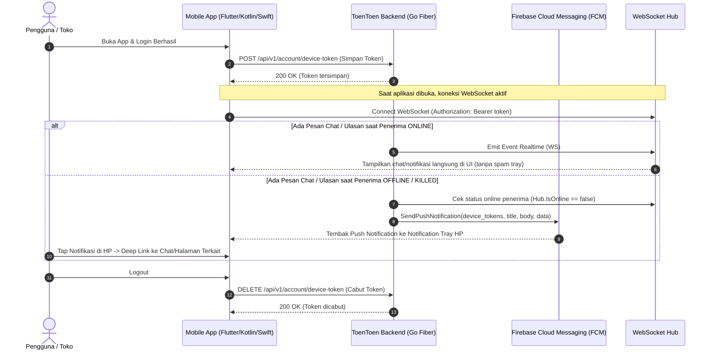

# 📱 Panduan & Alur Integrasi Push Notification (Offline Notifications)

Dokumen ini berisi spesifikasi API dan alur integrasi Push Notification backend **ToenToen** untuk aplikasi mobile (Android & iOS).

Push notification ini memastikan pengguna tetap menerima pemberitahuan penting (chat baru, ulasan toko, order/demand signal, promosi, dsb.) secara instan di panel notifikasi HP meskipun aplikasi sedang **ditutup total (killed)** atau **berjalan di background tanpa koneksi WebSocket aktif**.

---

## 🏗️ Arsitektur & Logika Pengiriman



---

## 1. Endpoint Simpan Device Token (Register Push Token)

Dipanggil oleh aplikasi mobile segera setelah user berhasil login atau saat refresh push token perangkat.

- **Method**: `POST`
- **URL**: `/api/v1/account/device-token`
- **Header**:
  - `Content-Type: application/json`
  - `Authorization: Bearer <auth_token>`

### Request Body:
```json
{
  "device_token": "eYxxxxxxx_token_fcm_dari_perangkat_mobile",
  "platform": "android"
}
```

#### Keterangan Field:
| Field | Tipe | Wajib | Keterangan |
|---|---|---|---|
| `device_token` | `string` | **Ya** | Token push yang diperoleh dari SDK FCM perangkat |
| `platform` | `string` | **Opsional** | `"android"` atau `"ios"` (default: `"android"`) |

> **Catatan Backend:** Sistem menggunakan strategi *Upsert* (`ON CONFLICT (fcm_token) DO UPDATE`). Jika 1 HP digunakan untuk berganti akun, token perangkat akan otomatis terasosiasi ke akun yang baru login sehingga akun lama tidak menerima notifikasi akun baru.

### Contoh Response Sukses (`200 OK`):
```json
{
  "code": 200,
  "responseCode": "00",
  "message": "Device token berhasil didaftarkan",
  "data": null
}
```

### Contoh Response Gagal (`400 Bad Request`):
```json
{
  "code": 400,
  "responseCode": "A1",
  "message": "device_token wajib diisi",
  "data": null
}
```

---

## 2. Endpoint Hapus Device Token (Revoke Token saat Logout)

Dipanggil saat user menekan tombol **Logout** di aplikasi mobile, agar HP tidak terus menerima notifikasi dari akun lama.

- **Method**: `DELETE`
- **URL**: `/api/v1/account/device-token`
- **Header**:
  - `Content-Type: application/json`
  - `Authorization: Bearer <auth_token>`

### Request Body (Opsional):
```json
{
  "device_token": "eYxxxxxxx_token_fcm_dari_perangkat_mobile"
}
```

#### Keterangan:
- Jika `device_token` dikirim: Backend hanya menghapus token spesifik perangkat tersebut.
- Jika request body kosong `{}`: Backend menghapus semua token perangkat yang terdaftar atas nama akun tersebut (logout dari semua perangkat).

### Contoh Response Sukses (`200 OK`):
```json
{
  "code": 200,
  "responseCode": "00",
  "message": "Device token berhasil dihapus",
  "data": null
}
```

---

## 3. Format Payload Push Notification & Deep Link

Saat event terjadi di backend dan pengguna tujuan sedang offline (`WebSocket Hub.IsOnline(recipient) == false`), backend secara otomatis mengirim push notification dengan struktur payload seragam berikut:

### Kontrak Payload Standar:
- `title`: Judul notifikasi / nama pengirim
- `body`: Ringkasan pesan / cuplikan ulasan / info status
- `data`: Key-value string map untuk navigasi deep link di mobile app

---

### A. Chat Toko (Direct Business Chat)
Dikirim saat customer mengirim chat ke toko, atau toko membalas chat ke customer.

#### Payload Push:
```json
{
  "notification": {
    "title": "Dapur Bunda Rumahan",
    "body": "Halo kak, pesanan soto ayamnya sedang kami siapkan ya!"
  },
  "data": {
    "conversation_id": "BCONV-20261020-001",
    "type": "business_chat",
    "action": "open_business_chat",
    "business_id": "BIZ-20261001-01",
    "sender_type": "merchant",
    "sender_name": "Dapur Bunda Rumahan"
  }
}
```

#### Penanganan di Mobile:
Saat notifikasi ditekan (`onNotificationOpenedApp` / `getInitialNotification`):
Buka halaman chat toko dengan parameter `conversation_id` dan `business_id`.

---

### B. Layanan Bantuan Live Chat (Customer Support)
Dikirim saat CS menjawab tiket keluhan pengguna, atau pengguna membalas chat CS.

#### Payload Push:
```json
{
  "notification": {
    "title": "ToenToen Support",
    "body": "Tim kami telah meninjau kendala pembayaran Anda. Silakan cek detail berikut."
  },
  "data": {
    "session_id": "LCS-20261020-009",
    "type": "support_chat",
    "action": "open_support_chat",
    "sender_type": "cs",
    "sender_name": "ToenToen Support"
  }
}
```

#### Penanganan di Mobile:
Buka layar Live Support Chat dengan parameter `session_id`.

---

### C. Ulasan Toko & Produk (Merchant Reviews)
Dikirim ke seluruh staf/owner toko saat ada customer yang memberikan ulasan.

#### Payload Push:
```json
{
  "notification": {
    "title": "Ulasan Baru untuk Toko Anda!",
    "body": "Pelanggan memberikan rating 5★: Makanannya sangat enak dan higienis..."
  },
  "data": {
    "type": "business_review",
    "action": "open_reviews",
    "business_id": "BIZ-20261001-01",
    "review_id": "REV-20261020-99",
    "notification_id": "NOTIF-20261020-88"
  }
}
```

#### Penanganan di Mobile:
Buka tab ulasan toko atau detail ulasan dengan `review_id`.

---

### D. Order / Demand Signal (Customer Signals)
Dikirim saat ada kebutuhan atau pesanan baru di sekitar lokasi toko.

#### Payload Push:
```json
{
  "notification": {
    "title": "Kebutuhan Baru di Sekitar Toko Anda!",
    "body": "Pelanggan di radius 2 km mencari: Katering Nasi Kotak 50 Porsi"
  },
  "data": {
    "type": "signal_match",
    "action": "open_signal_detail",
    "signal_id": "SIG-20261020-77",
    "notification_id": "NOTIF-20261020-66"
  }
}
```

---

## 4. Rekomendasi Integrasi di Sisi Frontend Mobile (Flutter / React Native)

1. **Setelah Login**:
   ```dart
   String? fcmToken = await FirebaseMessaging.instance.getToken();
   if (fcmToken != null) {
     await http.post(
       Uri.parse('$baseUrl/api/v1/account/device-token'),
       headers: {
         'Authorization': 'Bearer $authToken',
         'Content-Type': 'application/json',
       },
       body: jsonEncode({
         'device_token': fcmToken,
         'platform': Platform.isIOS ? 'ios' : 'android',
       }),
     );
   }
   ```

2. **Saat Token Berubah (`onTokenRefresh`)**:
   Daftarkan kembali token baru ke endpoint `POST /api/v1/account/device-token`.

3. **Sebelum Logout Selesai**:
   ```dart
   String? fcmToken = await FirebaseMessaging.instance.getToken();
   await http.delete(
     Uri.parse('$baseUrl/api/v1/account/device-token'),
     headers: {
       'Authorization': 'Bearer $authToken',
       'Content-Type': 'application/json',
     },
     body: jsonEncode({
       'device_token': fcmToken,
     }),
   );
   // Lanjutkan bersihkan local storage / session auth
   ```

4. **Navigasi Deep Link**:
   Periksa payload `data['action']` atau `data['type']`:
   - Jika `business_chat` -> Buka layar percakapan direct chat.
   - Jika `support_chat` -> Buka layar CS live chat.
   - Jika `business_review` -> Buka daftar ulasan toko.
   - Jika `signal_match` -> Buka detail permintaan pesanan.
