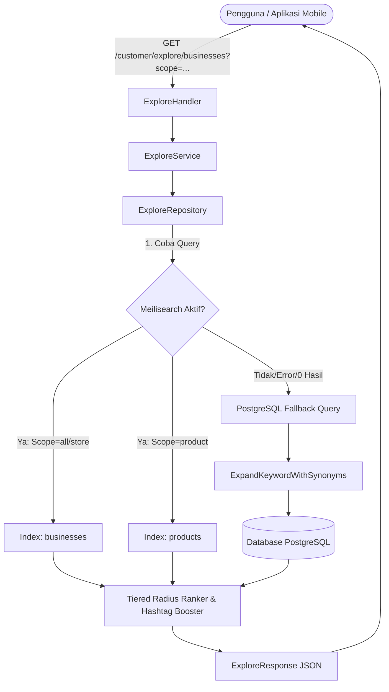

# Panduan & Dokumentasi Lengkap Fitur Search Engine Modern ToenToen

Dokumen ini menjelaskan implementasi, alur kerja, spesifikasi parameter, serta contoh respons untuk sistem mesin pencari (*search engine*) ToenToen yang telah ditingkatkan (*upgraded*) berbasis **Meilisearch Dual-Index Engine** dengan fallback cerdas ke **PostgreSQL**.

---

## 📌 Daftar Isi
1. [Prinsip & Aturan Bisnis Inti](#1-prinsip--aturan-bisnis-inti)
2. [Arsitektur Mesin Pencari Dual-Index](#2-arsitektur-mesin-pencari-dual-index)
3. [Toleransi Kesalahan Ketik (Typo) & Kamus Sinonim Statis](#3-toleransi-kesalahan-ketik-typo--kamus-sinonim-statis)
4. [Mekanisme Skala Prioritas Radius (Tiered Ranking)](#4-mekanisme-skala-prioritas-radius-tiered-ranking)
5. [Soft Filter / Ranking Booster vs Gatekeeping (Hard Filters)](#5-soft-filter--ranking-booster-vs-gatekeeping-hard-filters)
6. [Kebijakan Pembaruan Nama Toko & Audit Trail](#6-kebijakan-pembaruan-nama-toko--audit-trail)
7. [Standardisasi Tipe Toko (Store Types)](#7-standardisasi-tipe-toko-store-types)
8. [Tiga Pilihan Scope Pencarian](#8-tiga-pilihan-scope-pencarian)
9. [Dokumentasi API & Kontrak Request/Response](#9-dokumentasi-api--kontrak-requestresponse)
10. [Sinkronisasi & Pemulihan Indeks (Indexing & Healing)](#10-sinkronisasi--pemulihan-indeks-indexing--healing)

---

## 1. Prinsip & Aturan Bisnis Inti

Sistem mesin pencari ini dirancang untuk memenuhi standar mesin pencari modern (setara e-commerce terkemuka) dengan ketentuan manajerial berikut:

| No | Aturan Bisnis | Implementasi Sistem |
| :--- | :--- | :--- |
| **1** | **Typo & Slang Tolerance** | Menggunakan kamus sinonim lokal bahasa Indonesia (singkatan kuliner, gaul) dan konfigurasi toleransi saltik (*typo tolerance*) 1 typo (min 4 huruf) dan 2 typo (min 8 huruf). |
| **2** | **Skala Prioritas Radius** | Toko/produk $\le$ radius pilihan pengguna (misal 5 km) ditaruh di kelompok teratas (**Tier 1**). Toko/produk di luar radius ($>$ 5 km) ditaruh di kelompok bawah (**Tier 2**). Setiap kelompok diurutkan mandiri sesuai filter sort pengguna. |
| **3** | **Data Toko Selalu Terkini** | Mesin pencari **100% selalu mencerminkan nama dan data terbaru**. Nama toko lama TIDAK DAPAT dicari oleh publik, melainkan disimpan dalam tabel audit trail internal database (`business_name_histories`). |
| **4** | **Gatekeeping (Hard Filter)** | Filter ketersediaan operasional (`is_open_now`), diskon/promo aktif (`is_promo`), tipe gerai (`store_type`), rentang harga (`min_price`, `max_price`), dan tipe stok (`stock_types`). |
| **5** | **Soft Filter (Booster)** | Filter `hashtags` berfungsi sebagai *ranking booster* (menaikkan posisi item yang cocok ke peringkat atas pada masing-masing kelompok radius, tanpa membuang item lain). |
| **6** | **Tiga Pilihan Scope** | Scope `all` (kartu toko + produk yang cocok), scope `store` (kartu toko saja), dan scope `product` (kartu produk individual). |

---

## 2. Arsitektur Mesin Pencari Dual-Index

Sistem mengelola dua indeks utama di Meilisearch yang selalu tersinkronisasi secara real-time dengan database PostgreSQL:



1. **Indeks `"businesses"`**:
   - `searchableAttributes`: `name`, `products`, `category_names`, `tag_names`, `custom_tags`, `hashtags`, `store_type`, `store_type_label`, `city`, `address_detail`.
   - `filterableAttributes`: `_geo`, `rating`, `is_open`, `category_id`, `category_ids`, `category_names`, `tag_ids`, `tag_names`, `hashtags`, `store_type`, `has_promo`, `min_price`, `max_price`, `stock_types`.
   - `sortableAttributes`: `_geo`, `rating`, `review_count`, `min_price`.

2. **Indeks `"products"`**:
   - `searchableAttributes`: `product_name`, `business_name`, `category_names`, `hashtags`, `store_type_label`.
   - `filterableAttributes`: `_geo`, `price`, `final_price`, `is_discounted`, `stock_type`, `is_open`, `store_type`, `business_id`, `category_ids`, `category_names`, `hashtags`, `rating`.
   - `sortableAttributes`: `_geo`, `final_price`, `price`, `rating`, `created_at`.

---

## 3. Toleransi Kesalahan Ketik (Typo) & Kamus Sinonim Statis

### A. Kamus Sinonim Statis (`pkg/meilisearch/synonyms.go`)
Sistem dilengkapi dengan kamus komprehensif bahasa sehari-hari dan istilah lokal Indonesia:
- **Kopi & Minuman**: `kopsus` $\leftrightarrow$ `kopi susu`, `es kopi`, `coffee`; `ngopi` $\leftrightarrow$ `kopi`; `eskrim` $\leftrightarrow$ `es krim`, `ice cream`; `boba` $\leftrightarrow$ `bubble tea`; `coklat` $\leftrightarrow$ `cokelat`, `chocolate`.
- **Kuliner & Singkatan**: `nasgor` $\leftrightarrow$ `nasi goreng`; `mie` $\leftrightarrow$ `bakmi`, `mi`, `noodle`, `ramen`; `robar` $\leftrightarrow$ `roti bakar`, `toast`; `bakso` $\leftrightarrow$ `baso`, `meatball`; `pedas` $\leftrightarrow$ `pedes`, `spicy`, `hot`, `mercon`, `geprek`.
- **Pakaian & Fashion**: `baju` $\leftrightarrow$ `pakaian`, `kaos`, `tshirt`, `kemeja`; `sepatu` $\leftrightarrow$ `sneakers`, `shoes`; `hijab` $\leftrightarrow$ `jilbab`, `kerudung`.
- **Tempat & Format**: `warkop` $\leftrightarrow$ `warung kopi`, `kedai kopi`, `cafe`; `alun_alun` $\leftrightarrow$ `alun-alun`, `lapangan`; `pusat_belanja` $\leftrightarrow$ `mall`, `plaza`.
- **Saltik Umum**: `antri` $\leftrightarrow$ `antre`; `espreso` $\leftrightarrow$ `espresso`; `cappucino` $\leftrightarrow$ `cappuccino`.

### B. Fallback PostgreSQL Query Expansion
Jika Meilisearch sedang *maintenance* atau *offline*, fungsi `ExpandKeywordWithSynonyms(keyword)` secara otomatis memecah dan memperluas kata kunci pencarian menjadi klausa `ILIKE` dengan sinonimnya di database SQL, memastikan pencarian tetap cerdas kapan pun!

---

## 4. Mekanisme Skala Prioritas Radius (Tiered Ranking)

Berbeda dengan filter geolokasi kaku yang menghapus toko di luar batas (misal toko 5.1 km langsung hilang), ToenToen menerapkan **Skala Prioritas Dua Tingkat**:

```
[Hasil Pencarian]
│
├── 🟢 TIER 1: Di Dalam Radius (misal ≤ 5.0 km)
│    ├── Peringkat 1: Toko A (Jarak 2.1 km) [Hashtag Match / Boosted] ⭐
│    ├── Peringkat 2: Toko B (Jarak 1.2 km) [Normal Sort: Nearest]
│    └── Peringkat 3: Toko C (Jarak 4.5 km) [Normal Sort: Nearest]
│
└── 🟡 TIER 2: Melebihi Radius (misal > 5.0 km)
     ├── Peringkat 4: Toko D (Jarak 6.2 km) [Hashtag Match / Boosted] ⭐
     ├── Peringkat 5: Toko E (Jarak 5.8 km) [Normal Sort: Nearest]
     └── Peringkat 6: Toko F (Jarak 11.0 km) [Normal Sort: Nearest]
```

### Karakteristik & Aturan:
1. **Tier 1 (Within Radius)**: Setiap item memiliki penanda `"is_within_radius": true`.
2. **Tier 2 (Outside Radius)**: Setiap item memiliki penanda `"is_within_radius": false`.
3. Item di Tier 2 **TIDAK AKAN PERNAH** melompati item di Tier 1, apa pun skor atau hashtag boosternya.
4. Di dalam masing-masing Tier, pengurutan dilakukan secara independen mengikuti parameter `sort` yang dipilih pengguna (`nearest`, `rating`, `price_asc`, `price_desc`, `latest`).

---

## 5. Soft Filter / Ranking Booster vs Gatekeeping (Hard Filters)

| Jenis Filter | Parameter | Sifat | Perilaku Sistem |
| :--- | :--- | :--- | :--- |
| **Soft Filter (Booster)** | `hashtags` / `hashtag` | *Booster* | **TIDAK MENGELIMINASI ITEM**. Item yang memiliki hashtag yang cocok akan dinaikkan ke puncak urutan di dalam tier radiusnya masing-masing. |
| **Hard Filter (Gatekeeper)** | `is_open_now` | *Gatekeeper* | Hanya menampilkan toko/produk dari toko yang sedang buka saat ini. |
| **Hard Filter (Gatekeeper)** | `is_promo` | *Gatekeeper* | Hanya menampilkan toko/produk yang memiliki diskon aktif atau promosi aktif. |
| **Hard Filter (Gatekeeper)** | `store_type` | *Gatekeeper* | Hanya menampilkan tipe gerai yang dipilih (misal: `gerobak`, `rumah`). |
| **Hard Filter (Gatekeeper)** | `min_price`, `max_price` | *Gatekeeper* | Membatasi hasil ke item yang berada dalam rentang anggaran pengguna. |
| **Hard Filter (Gatekeeper)** | `stock_types` | *Gatekeeper* | Menyaring ketersediaan stok (`in_stock`, `pre_order`, `limited`, `always_available`). |
| **Hard Filter (Gatekeeper)** | `category_ids`, `category` | *Gatekeeper* | Hanya menampilkan kategori yang dipilih. |

---

## 6. Kebijakan Pembaruan Nama Toko & Audit Trail

Sesuai instruksi manajerial:
1. **Pencarian Publik 100% Data Baru**:
   - Ketika merchant mengubah nama toko (misal dari `"Ahah"` menjadi `"Dapur Bunda Rumahan"`), dokumen di Meilisearch langsung diperbarui ke nama baru.
   - Indeks lama dihapus dan digantikan dengan nama baru. Pengguna yang mencari `"Ahah"` tidak akan menemukan toko tersebut.
2. **Audit Trail Internal Database (`business_name_histories`)**:
   - Setiap pergantian nama toko otomatis dicatat ke tabel `business_name_histories`:
     - `history_id`: UUID unik riwayat
     - `business_id`: ID bisnis terkait
     - `old_name`: Nama sebelum diganti
     - `new_name`: Nama setelah diganti
     - `changed_by`: ID akun merchant yang melakukan perubahan
     - `created_at`: Waktu perubahan (WIB)

---

## 7. Standardisasi Tipe Toko (Store Types)

Seluruh tipe gerai disimpan dalam format `snake_case` di database dan disajikan ke antarmuka dengan label bahasa Indonesia:

| Nilai DB (`store_type`) | Label Tampilan (`store_type_label`) | Deskripsi Singkat |
| :--- | :--- | :--- |
| `rumah` | Rumah / Dapur Rumahan | Usaha kuliner/jasa rumahan |
| `keliling` | Pedagang Keliling | Pedagang keliling sepeda/motor/jalan kaki |
| `gerobak` | Gerobak / Kaki Lima | Gerai kaki lima / booth trotoar |
| `toko` | Toko / Warung Kelontong | Toko fisik menetap / warung kelontong |
| `ruko` | Ruko / Kios Komersial | Rumah toko / kios ruko komersial |
| `pasar` | Pasar Tradisional | Kios/los di pasar tradisional |
| `alun_alun` | Alun-Alun / Lapangan Terbuka | Stand/booth di ruang publik terbuka |
| `pusat_belanja` | Pusat Perbelanjaan / Mall | Tenant/island di mall perbelanjaan |
| `acara_musiman` | Acara / Musiman (Pop-up) | Bazaar, pameran, atau festival musiman |
| `regular` | Regular | Format standar default |

---

## 8. Tiga Pilihan Scope Pencarian

API mendukung 3 nilai untuk parameter `scope`:

### 1. `scope=all` (Default)
Menampilkan daftar kartu toko (`businesses`), di mana setiap toko memuat cuplikan produk yang cocok (`matched_products`) di bawahnya.
- Sangat cocok untuk halaman utama pencarian (Explore).

### 2. `scope=store`
Hanya menampilkan kartu profil toko (`businesses`). Array `matched_products` dikosongkan agar respon hemat bandwidth dan cepat.
- Sangat cocok untuk tab "Toko" pada filter hasil pencarian.

### 3. `scope=product`
Menampilkan kartu produk individual secara langsung (`products`) yang dicari dari indeks produk Meilisearch.
- Setiap produk memuat `product_name`, `final_price`, `is_discounted`, `business_name`, `store_type_label`, `distance`, dan `is_within_radius`.
- Sangat cocok untuk tab "Produk" pada filter hasil pencarian.

---

## 9. Dokumentasi API & Kontrak Request/Response

### Endpoint Utama
```http
GET /api/v1/customer/explore/businesses
GET /api/v1/customer/explore/search
GET /api/v1/customer/explore/products
```

### Parameter Query

| Parameter | Tipe Data | Wajib? | Default | Contoh | Keterangan |
| :--- | :--- | :--- | :--- | :--- | :--- |
| `scope` | String | Tidak | `all` | `all`, `store`, `product` | Lingkup pencarian. |
| `keyword` / `q` | String | Tidak | `""` | `kopsus`, `nasgor`, `eskrim` | Kata kunci pencarian (mendukung typo & slang). |
| `lat` | Float | Tidak | `0` | `-6.2088` | Koordinat latitude pengguna. |
| `lng` | Float | Tidak | `0` | `106.8456` | Koordinat longitude pengguna. |
| `radius` | Integer | Tidak | `10` | `5` | Radius prioritas dalam **kilometer (km)**. |
| `sort` | String | Tidak | `nearest` | `nearest`, `rating`, `price_asc`, `price_desc`, `latest` | Mode pengurutan. Alias: `murah`, `mahal`, `terdekat`. |
| `hashtags` | String | Tidak | `""` | `pedas,promo,kopi` | **Soft Filter / Booster** (dipisahkan koma). |
| `is_open_now` | Boolean | Tidak | - | `true` | **Hard Filter**: Hanya toko yang sedang buka. |
| `is_promo` | Boolean | Tidak | - | `true` | **Hard Filter**: Hanya produk/toko yang sedang diskon. |
| `store_type` | String | Tidak | - | `gerobak`, `rumah,toko` | **Hard Filter**: Tipe gerai (dipisahkan koma). |
| `min_price` | Float | Tidak | - | `10000` | **Hard Filter**: Batas harga minimum. |
| `max_price` | Float | Tidak | - | `50000` | **Hard Filter**: Batas anggaran harga maksimum. |
| `stock_types` | String | Tidak | - | `in_stock`, `pre_order` | **Hard Filter**: Status stok produk. |
| `category_ids` | String | Tidak | - | `1,2,5` | **Hard Filter**: ID Kategori (dipisahkan koma). |
| `page` | Integer | Tidak | `1` | `1` | Halaman data. |
| `limit` | Integer | Tidak | `10` | `10` | Jumlah data per halaman. |

---

### Contoh Request & Response

#### 1. Contoh: Pencarian Scope `all` (Toko + Matched Products)
```http
GET /api/v1/customer/explore/businesses?q=kopi&lat=-6.2000&lng=106.8000&radius=5&hashtags=pedas&is_open_now=true&scope=all HTTP/1.1
Host: api.toentoen.com
```

**Response JSON:**
```json
{
  "code": "00",
  "message": "Berhasil memuat eksplorasi bisnis",
  "data": {
    "scope": "all",
    "businesses": [
      {
        "id": "BIZ-101",
        "name": "Kopi Janji Senja",
        "store_type": "ruko",
        "store_type_label": "Ruko / Kios Komersial",
        "is_open": true,
        "rating": 4.8,
        "review_count": 120,
        "has_promo": true,
        "_geoDistance": 1.85,
        "is_within_radius": true,
        "hashtags": ["kopi", "pedas"],
        "city": "Jakarta Selatan",
        "address_detail": "Jl. Fatmawati Raya No. 12",
        "matched_products": [
          {
            "product_id": "PRD-201",
            "product_name": "Kopi Susu Senja",
            "price": 22000,
            "final_price": 18000,
            "is_discounted": true,
            "discount_pct": 18.18,
            "stock_type": "in_stock",
            "product_preview": ["https://storage.toentoen.com/p1.jpg"]
          }
        ]
      },
      {
        "id": "BIZ-109",
        "name": "Kedai Kopi Pelosok",
        "store_type": "rumah",
        "store_type_label": "Rumah / Dapur Rumahan",
        "is_open": true,
        "rating": 4.5,
        "review_count": 45,
        "has_promo": false,
        "_geoDistance": 8.30,
        "is_within_radius": false,
        "hashtags": ["kopi"],
        "city": "Depok",
        "address_detail": "Jl. Margonda Kav. 5",
        "matched_products": []
      }
    ],
    "summary": {
      "within_radius_count": 1,
      "outside_radius_count": 1,
      "total_items": 2
    },
    "pagination": {
      "current_page": 1,
      "total_pages": 1,
      "total_items": 2
    }
  }
}
```

---

#### 2. Contoh: Pencarian Scope `product` (Kartu Produk Individual)
```http
GET /api/v1/customer/explore/businesses?q=eskrim&scope=product&lat=-6.2000&lng=106.8000&radius=5&sort=price_asc HTTP/1.1
Host: api.toentoen.com
```

**Response JSON:**
```json
{
  "code": "00",
  "message": "Berhasil memuat eksplorasi bisnis",
  "data": {
    "scope": "product",
    "businesses": [],
    "products": [
      {
        "product_id": "PRD-550",
        "product_name": "Es Krim Vanilla Cone",
        "product_preview": ["https://storage.toentoen.com/ice1.jpg"],
        "price": 12000,
        "final_price": 10000,
        "is_discounted": true,
        "discount_pct": 16.6,
        "stock_type": "in_stock",
        "business_id": "BIZ-88",
        "business_name": "Gelato Corner",
        "store_type": "gerobak",
        "store_type_label": "Gerobak / Kaki Lima",
        "is_open": true,
        "rating": 4.9,
        "review_count": 89,
        "hashtags": ["eskrim", "manis"],
        "_geoDistance": 2.10,
        "is_within_radius": true
      },
      {
        "product_id": "PRD-880",
        "product_name": "Ice Cream Sundae Jumbo",
        "product_preview": ["https://storage.toentoen.com/ice2.jpg"],
        "price": 30000,
        "final_price": 25000,
        "is_discounted": true,
        "discount_pct": 16.6,
        "stock_type": "in_stock",
        "business_id": "BIZ-99",
        "business_name": "Pusat Gelato Mall",
        "store_type": "pusat_belanja",
        "store_type_label": "Pusat Perbelanjaan / Mall",
        "is_open": true,
        "rating": 4.7,
        "review_count": 210,
        "hashtags": ["ice cream"],
        "_geoDistance": 7.40,
        "is_within_radius": false
      }
    ],
    "summary": {
      "within_radius_count": 1,
      "outside_radius_count": 1,
      "total_items": 2
    },
    "pagination": {
      "current_page": 1,
      "total_pages": 1,
      "total_items": 2
    }
  }
}
```

---

## 10. Sinkronisasi & Pemulihan Indeks (Indexing & Healing)

### A. Sinkronisasi Otomatis Real-time
Setiap ada aksi mutasi data:
- **Toko dibuat / diupdate**: Otomatis memperbarui dokumen toko dan seluruh produknya di Meilisearch via `SyncBusiness`.
- **Produk dibuat / diupdate / dihapus**: Otomatis memperbarui dokumen toko dan indeks produk individual via `SyncProduct` / `SyncBusinessProducts`.
- **Promosi aktif / berakhir**: Scheduler dan worker otomatis memicu re-sync toko sehingga `has_promo` dan harga diskon terbarui seketika.

### B. Endpoint Pemulihan / Manual Re-Index
Jika server Meilisearch baru saja di-deploy atau di-restart dari database kosong, tim DevOps / backend dapat memicu sinkronisasi massal seluruh data dengan memanggil:
```http
POST /api/v1/customer/explore/sync HTTP/1.1
Host: api.toentoen.com
```

**Response JSON:**
```json
{
  "code": "00",
  "message": "Berhasil menyinkronkan 142 bisnis ke Meilisearch",
  "data": {
    "total_synced": 142
  }
}
```
Endpoint ini otomatis:
1. Menyetel kamus sinonim & toleransi *typo* untuk indeks `"businesses"` dan `"products"`.
2. Menyetel seluruh atribut *filterable*, *sortable*, dan *searchable*.
3. Mengunggah seluruh toko dan produk aktif secara serentak ke Meilisearch.
